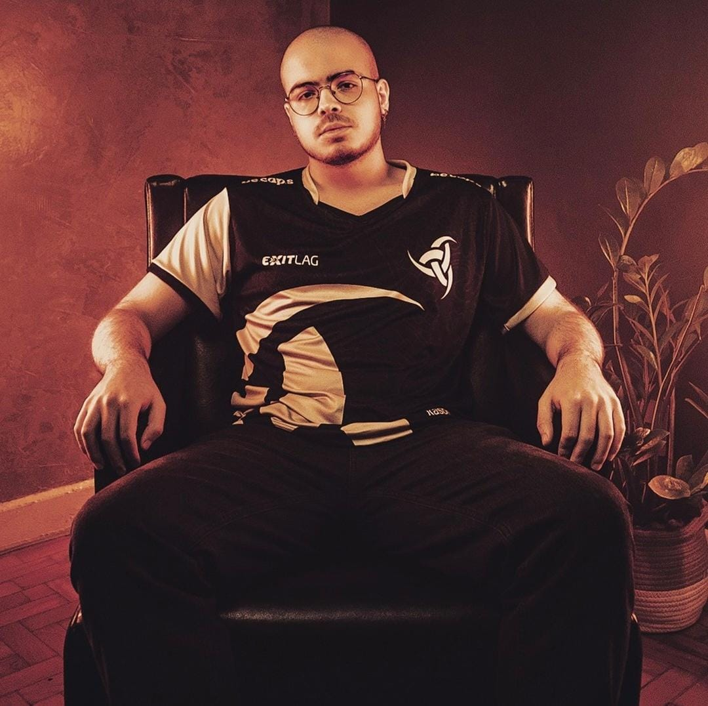
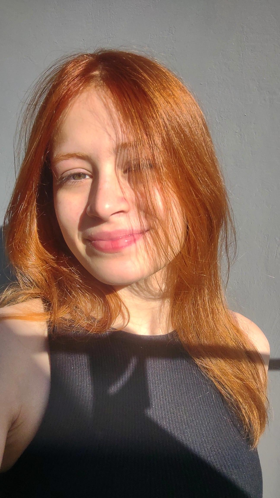

# ☀️ Turma do Bem — Front-End Design Engineering

Projeto acadêmico desenvolvido para a disciplina de **Front-End Design Engineering**, da FIAP, no Challenge 2026, em parceria com a ONG Turma do Bem.

## 💙 Sobre o projeto

O **Turma do Bem** é uma proposta de plataforma digital criada para modernizar e ampliar a presença digital da organização, facilitando o acesso às informações do projeto e apresentando uma solução para apoiar a gestão de doadores, empresas e parceiros.

O website apresenta a proposta da plataforma, seus principais recursos, informações sobre o projeto e sua equipe, além de um protótipo visual para demonstrar a solução.

## 🎯 Objetivos

- Desenvolver uma interface web organizada, intuitiva e responsiva.
- Aplicar os fundamentos de HTML5, CSS3 e JavaScript.
- Utilizar tags semânticas para estruturar o conteúdo.
- Facilitar a navegação e a experiência dos usuários.
- Apresentar a proposta de solução digital para a Turma do Bem.
- Praticar versionamento de código com Git e GitHub.

## 🛠️ Tecnologias utilizadas

- **HTML5:** estruturação e organização das páginas.
- **CSS3:** estilização, layout e identidade visual (uma única folha de estilos).
- **JavaScript:** menu do celular, validação dos formulários, FAQ, filtro de doadores e animações.
- **Git:** controle de versão do projeto.
- **GitHub:** armazenamento e gerenciamento do repositório.
- **Visual Studio Code:** ambiente de desenvolvimento.

## 📂 Estrutura do projeto

```text
📁 projeto-turma-do-bem/
├── 📁 css/
│   └── style.css        # estilos de todas as páginas
├── 📁 js/
│   └── main.js          # interações de todas as páginas
├── 📁 imagens/
│   ├── logo.svg
│   ├── sol-fino.svg     # sol decorativo do fundo
│   └── 📁 icones/
├── 📁 img/              # dente 3D e fotos dos integrantes
├── index.html
├── sobre.html
├── solucao.html
├── painel.html
├── integrantes.html
├── faq.html
├── contato.html
├── login.html
├── cadastro.html
└── README.md
```


## ✨ Funcionalidades e páginas

- **Início:** apresentação do projeto e contextualização do problema da saúde bucal no Brasil.
- **Sobre:** informações sobre a iniciativa e o projeto acadêmico.
- **Solução:** apresentação da proposta e dos recursos da plataforma.
- **Protótipo:** demonstração visual do painel de indicadores e da gestão de doadores.
- **Integrantes:** apresentação da equipe responsável pelo desenvolvimento.
- **FAQ:** perguntas frequentes sobre o projeto.
- **Contato:** informações e formulário com validação.
- **Login e Cadastro:** acesso à plataforma, com validação dos campos.

## 📚 Aprendizados

O desenvolvimento deste projeto permite aplicar conceitos fundamentais de desenvolvimento front-end, incluindo estruturação semântica, organização de arquivos, estilização de interfaces, acessibilidade básica e navegação entre páginas.

Também proporciona experiência prática com versionamento de código e trabalho colaborativo, aproximando os conhecimentos estudados em sala de aula de um projeto com propósito social.

## 🤝 Contexto acadêmico

**Instituição:** FIAP  
**Curso:** Análise e Desenvolvimento de Sistemas  
**Disciplina:** Front-End Design Engineering  
**Projeto:** Challenge FIAP + Turma do Bem  
**Ano:** 2026

## 👩‍🏫 Autores
- RM576314 — Enrique Trindade Ferreira Silva — 1TDSPA
- LinkedIn: https://www.linkedin.com/in/enrique-trindade-46a0012b4/
- GitHub: https://github.com/enriquetrindade


- RM575649 — Júlio Bernardes da Silva — 1TDSPA
- LinkedIn: https://www.linkedin.com/in/julio-bernardes-da-silva-40738b431/
- GitHub: https://github.com/JulioSilva101


- RM574491 — Marina Santana Queiroz — 1TDSPA
- LinkedIn: https://www.linkedin.com/in/marina-santana-queiroz-9baa77241/
- GitHub: https://github.com/marinasantanaq


- RM575635 — Rafael Madeira Gomes Ribeiro — 1TDSPA
- LinkedIn: https://www.linkedin.com/in/rafael-madeira-b8545b312/
- GitHub: https://github.com/Ribeir0296


- RM576524 — Sofia Oliveira Gonçalves — 1TDSPA
- LinkedIn: https://www.linkedin.com/in/sofia-goncalves-272472431/
- GitHub: https://github.com/sofiaolivagoliva


---

*Desenvolvido com 💙 para conectar tecnologia, impacto social e sorrisos.* ☀️

--- 

*Link do repositório:  https://github.com/Ribeir0296/Sprint-Front

